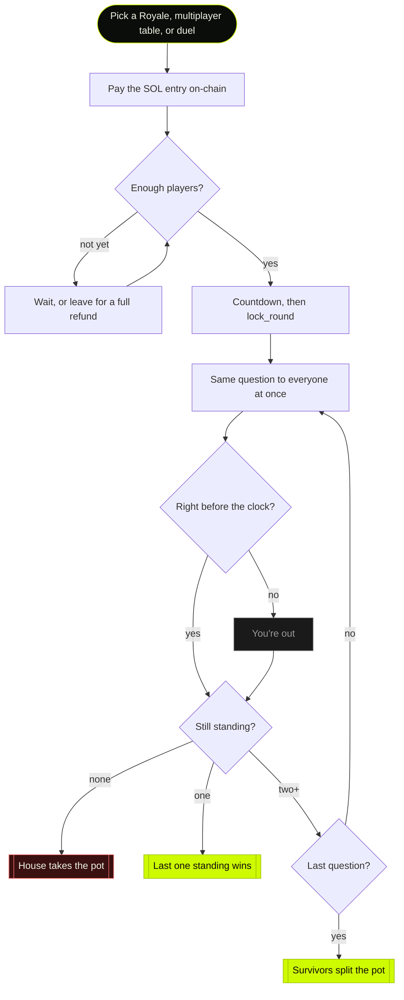
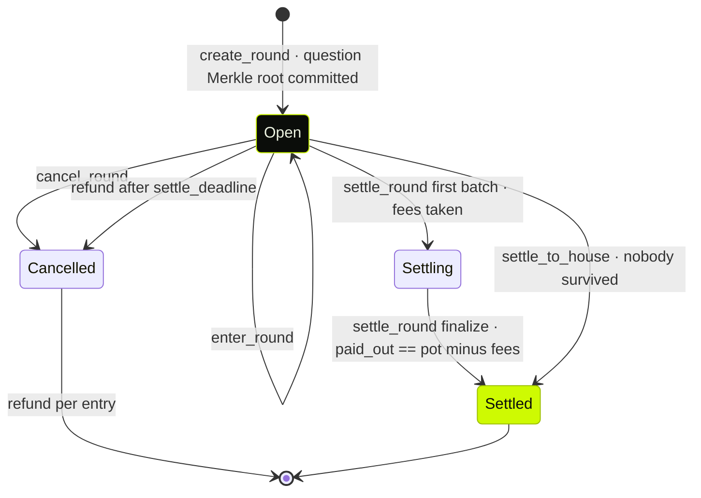
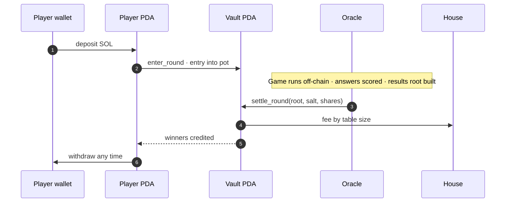
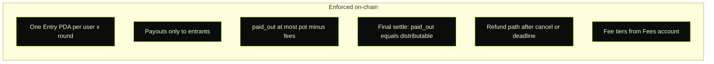
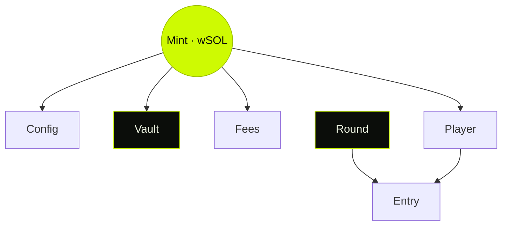

<p align="center">
  
</p>

<p align="center">
  
</p>

<p align="center">
  <strong>Trivia for the pot. Sealed questions, on-chain settlement.</strong><br/>
  Entry fees never sit with the server. This Anchor program holds every pot and enforces who gets paid.
</p>

<p align="center">
  <a href="https://resolved.fun"></a>
  <a href="https://explorer.solana.com/address/BJoVhD81MFEWzpbXKhuvZmh8HiA5bU3RJ9eirTbuSpNy"></a>
  <a href="https://www.anchor-lang.com/"></a>
  <a href="https://solana.com/"></a>
</p>

<p align="center">
  
</p>

---

## `resolved_pool`

Public source for the Solana program behind [resolved.fun](https://resolved.fun).

Players pay a SOL entry into a shared pot. Everyone gets the same question at the same moment. One miss and you're out. The last player standing takes the pot, or survivors split it. If nobody survives, the house takes it.

The game server is the **oracle** (creates rounds, scores answers, settles). This program is the **money path** the oracle cannot bend.

| | |
| :--- | :--- |
| **Program ID (mainnet)** | [`BJoVhD81MFEWzpbXKhuvZmh8HiA5bU3RJ9eirTbuSpNy`](https://explorer.solana.com/address/BJoVhD81MFEWzpbXKhuvZmh8HiA5bU3RJ9eirTbuSpNy) |
| **Anchor** | 0.30.1 |
| **Pool mint** | Wrapped SOL |
| **Fees** | House rake 0 · creator 1% / 2%@5+ / 5%@10+ |

---

## How a game works



### Four rules (same at every table)

| # | Rule | Detail |
| :-: | :--- | :--- |
| 01 | **Same question, same moment** | Pushed to every seat at once; option order shuffled per player |
| 02 | **One miss and you're out** | Wrong answer or timeout ends your run |
| 03 | **Speed never counts** | 0.2s or the buzzer: only correct matters |
| 04 | **Last one standing takes it** | Or survivors split. If nobody survives, the house takes the pot |

---

## On-chain round lifecycle



| Instruction | Who | What it does |
| :--- | :--- | :--- |
| `create_round` | Oracle | Opens a round with fee, caps, deadlines, and a **commit** to the question set |
| `enter_round` | Player | Moves entry fee from in-program balance into the pot; creates Entry PDA |
| `leave_round` | Oracle | Lone player exits before anyone else joins: full refund, seat freed |
| `lock_round` | Oracle | Closes entries (sets `locks_at` to now) |
| `settle_round` | Oracle | Batched winner credits; final batch requires exact payout |
| `settle_to_house` | Oracle | No survivors: fees, then remainder to house balance |
| `cancel_round` | Oracle | Marks cancelled so refunds can run |
| `refund` | **Anyone** | Returns entry after cancel, or after settle deadline on an open round |

---

## Money flow



### Fee schedule (by table size)

Fees are read from the round at settlement. The server cannot pick a different rate.

| Table size | Creator fee | Notes |
| :--- | ---: | :--- |
| 2-4 players | **1%** | Duels, small tables |
| 5-9 players | **2%** | Full multiplayer |
| 10+ players | **5%** | Mostly Royales |

Hard ceiling: house rake + creator fee at most **20%**.

---

## What the program guarantees



The oracle runs the game (questions, scoring, sockets). It **cannot**:

- pay a wallet that never entered
- pay more than the pot allows
- finalize a settlement with leftover or overshot lamports
- skip the fee schedule stored on-chain

---

## Account model

| Account | Seeds | Purpose |
| :--- | :--- | :--- |
| `Config` | `["config", mint]` | Admin, oracle, rake, caps, pause |
| `Vault` | `["vault", mint]` | Token account holding all pots |
| `Fees` | `["fees", mint]` | Creator pubkey + tiered bps |
| `Player` | `["player", mint, user]` | In-program balance |
| `Round` | `["round", round_id]` | Pot, players, status, commit, deadlines |
| `Entry` | `["entry", round, user]` | Proof of entry; paid / refunded flags |



Pool accounts are seeded by the mint, so a USDC pool is a second init, not a fork.

---

## Mainnet addresses

| Role | Address |
| :--- | :--- |
| Program | [`BJoVhD81MFEWzpbXKhuvZmh8HiA5bU3RJ9eirTbuSpNy`](https://explorer.solana.com/address/BJoVhD81MFEWzpbXKhuvZmh8HiA5bU3RJ9eirTbuSpNy) |
| Config | [`DwLsBD9RMWfiUGoJC4FhVSN4M6A4jYtTiroJwUpP685N`](https://explorer.solana.com/address/DwLsBD9RMWfiUGoJC4FhVSN4M6A4jYtTiroJwUpP685N) |
| Vault | [`7YwSkavDjnyvEqARuz1qtXdJfCSpzQQudCDqg83aK5sc`](https://explorer.solana.com/address/7YwSkavDjnyvEqARuz1qtXdJfCSpzQQudCDqg83aK5sc) |
| Fees | [`FstnWK8PkzprgAhSaDmzDsfy86nDH6NbRrmUDRPgYVuV`](https://explorer.solana.com/address/FstnWK8PkzprgAhSaDmzDsfy86nDH6NbRrmUDRPgYVuV) |
| Oracle | [`GikB9ioECRURhnR2uRLJtJnFuXVxoGknuZRYEy9YTy5J`](https://explorer.solana.com/address/GikB9ioECRURhnR2uRLJtJnFuXVxoGknuZRYEy9YTy5J) |
| House | [`6PQ9ULgtZnsvCsTRinDRdiVaHayuAykn15Do5WSMBKm7`](https://explorer.solana.com/address/6PQ9ULgtZnsvCsTRinDRdiVaHayuAykn15Do5WSMBKm7) |

---

## Build & test

```bash
anchor build
anchor test
```

Requires Rust, Solana CLI, Anchor **0.30.1**, and Node 20+.

---

## Security notes

- Admin / upgrade authority stays offline for mainnet. Never on the production host.
- The oracle key is the only hot signer the game server needs.
- Questions are committed as a Merkle root before play; salt revealed after settle.
- Overflow checks are on in the program crate.

Found something? Open an issue or reach out on [X](https://x.com/resolvedfun).

---

## License

Proprietary for now. Contact before reuse. Source is public so anyone can verify the money rules.

---

<p align="center">
  
  <br/>
  <sub>built for the pot · <a href="https://resolved.fun">resolved.fun</a></sub>
</p>
